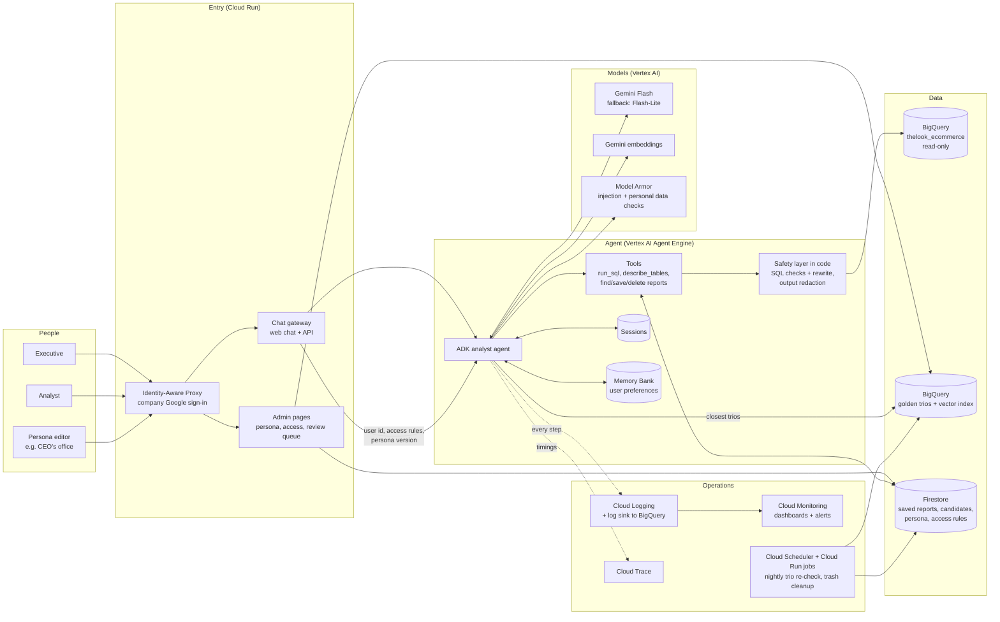
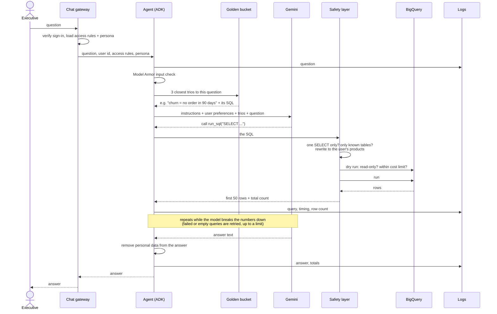
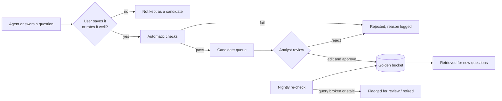
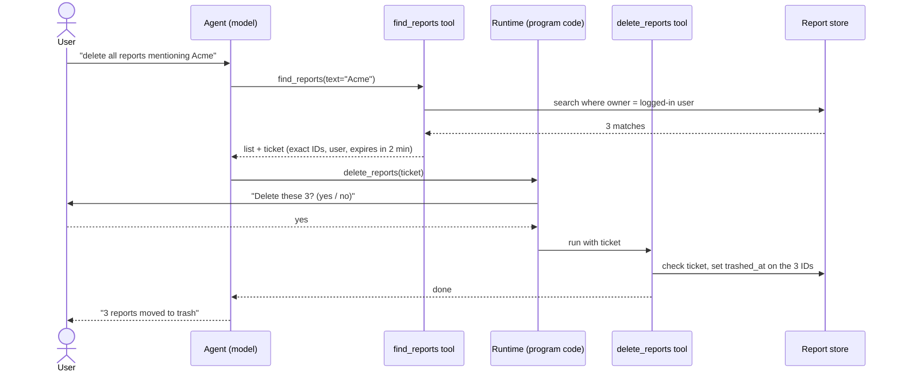

# Design Document

A chat assistant that lets non-technical executives ask questions about the company's sales data in plain English, discuss the answers, and get written reports with action items.

This document covers the production design and how the prototype in this repo relates to it. Every requirement in the brief has its own section below. Each one says what the production system does and what the prototype does today. For setup and an example run, see the [README](../README.md).

## The short version

An ADK agent using Gemini answers questions by writing SQL against BigQuery, then explains the result in plain English. In production it runs on Google Cloud: sign-in through Identity-Aware Proxy, a chat gateway on Cloud Run, the agent on Vertex AI Agent Engine, app data in Firestore, and logs and traces in Cloud Logging and Cloud Trace. The guiding rule is that **the model proposes and the code decides**: anything that must never happen is blocked in code, not by asking the model.

| Requirement | How it's solved | Prototype |
|---|---|---|
| 1. Hybrid intelligence | Before each question, code adds the closest analyst-written trios (question → SQL → report) to the agent's instructions. Agent reports only become trios after an analyst approves them. | Yes: 13 trios, Gemini embeddings |
| 2. Safety and personal data | Every query is checked and rewritten in code, so it can only read the user's own products and never sees personal columns. A BigQuery dry run enforces read-only access and a cost cap. Answers are scanned for emails. | Yes |
| 3. Destructive operations | Delete needs a ticket naming the exact reports. The program, not the model, asks the user to confirm. Deleted reports go to the trash, with undo. | Yes |
| 4. Learning loop | Memory Bank remembers each user's preferred format. The system improves through reviewed trios and a weekly review of failures, never by rewriting itself. | Design only |
| 5. Resilience | Failed or empty queries go back to the model to fix, with limits per question. Gemini calls are retried with backoff and a timeout. Outages get plain messages instead of crashes. | Yes |
| 6. Quality assurance | An evaluation set with known answers, a 100% safety bar, a second model grading answers against the user's intent, and analyst spot checks. | 75 automated tests |
| 7. Observability | One structured log line per step for every question, plus dashboards and alerts on failure rate, speed, cost and redactions. | Yes: activity log with a viewer |
| 8. Persona | Tone lives in Firestore and is edited on an admin page. The agent reads it at the start of each conversation, with no redeploy. Safety rules sit outside it, in code. | Design only |

**Contents**

1. [Architecture](#architecture)
2. [Why these services, models and framework](#why-these-services-models-and-framework)
3. [One question, end to end](#one-question-end-to-end)
4. [Requirement 1: Hybrid intelligence (the golden bucket)](#requirement-1-hybrid-intelligence-the-golden-bucket)
5. [Requirement 2: Safety, personal data and access](#requirement-2-safety-personal-data-and-access)
6. [Requirement 3: Saved reports and destructive operations](#requirement-3-saved-reports-and-destructive-operations)
7. [Requirement 4: The learning loop](#requirement-4-the-learning-loop)
8. [Requirement 5: Resilience and error handling](#requirement-5-resilience-and-error-handling)
9. [Requirement 6: Quality assurance](#requirement-6-quality-assurance)
10. [Requirement 7: Observability](#requirement-7-observability)
11. [Requirement 8: Persona management](#requirement-8-persona-management)
12. [Adding new capabilities](#adding-new-capabilities)
13. [Where data is stored](#where-data-is-stored)
14. [Prototype vs production](#prototype-vs-production)

## Architecture

Everything runs on Google Cloud. The sales data is already in BigQuery, so keeping the rest of the system there means one login system, one set of permissions and one place to look at logs.



**The building blocks**

| Block | Service | What it does |
|---|---|---|
| Sign-in | Identity-Aware Proxy (IAP) | Only company Google accounts get in. The gateway receives a verified user id, so the agent always knows who is asking. |
| Chat gateway | Cloud Run | Serves the web chat and an API. Looks up the user's access rules and the current persona, then passes the question to the agent. Shows confirmation prompts (for deletes) itself, outside the model. |
| Admin pages | Cloud Run (same service, separate pages) | Persona editor, access rules editor, golden bucket review queue. For non-developers. |
| Agent | ADK agent hosted on Vertex AI Agent Engine | Runs the conversation: calls Gemini, calls tools, keeps the session. Agent Engine is Google's managed hosting for agents. It provides sessions, Memory Bank and tracing, so we don't build those ourselves. (Google is folding Agent Engine into what it now calls Gemini Enterprise Agent Platform. The pieces are the same under the new name.) |
| Safety layer | Our code, inside the agent's tools | Checks and rewrites every query, and cleans every answer. It's code, not instructions, so the model can't talk its way past it. See [Requirement 2](#requirement-2-safety-personal-data-and-access). |
| Language model | Gemini Flash on Vertex AI, with Flash-Lite as fallback | Understands the question, writes SQL, explains results. |
| Embeddings | Gemini embedding model | Turns questions into vectors, so similar past questions can be found. |
| Prompt checks | Model Armor | Scans questions for prompt-injection attempts, and answers for personal data, as a second layer behind our own code. |
| Sales data | BigQuery, `thelook_ecommerce` | Read-only. The agent's service account can read and run queries, nothing else. |
| Golden bucket | A BigQuery table with a vector index | Analyst-reviewed trios. Similarity search runs inside BigQuery, so no extra database is needed. |
| App data | Firestore | Saved reports, candidate trios waiting for review, persona text, access rules. Small documents that change often. |
| Logs and traces | Cloud Logging, Cloud Trace, Cloud Monitoring | One structured log line per step, a timeline per question, dashboards and alerts. Logs are also copied to BigQuery for deeper analysis. |
| Scheduled jobs | Cloud Scheduler + Cloud Run jobs | Nightly: re-run every golden query, permanently delete reports trashed more than 30 days ago. |
| Secrets | Secret Manager | API keys and other secrets. No keys in code or config files. |

## Why these services, models and framework

**Google Cloud.** Using Google Cloud means one identity system (IAP and service accounts) controls access to everything, logs from every part land in the same place, and there is no traffic or permission setup between two clouds.

**Gemini.** The prototype uses **Gemini 3.5 Flash-Lite**, which is cheap and fast and stays within the free tier's rate limits. It handled every question we tried, including multi-step "why" questions. In production we'd use **Gemini Flash** as the main model, for better reasoning on long analyses, and fall back to Flash-Lite when Flash is overloaded. Both run on Vertex AI, which keeps traffic inside the Google Cloud project and supports provisioned capacity if usage grows. Similarly we have used Gemini embeddings.

**ADK (Google's Agent Development Kit).** I chose ADK because of its integration with BigQuery, Gemini and Google Cloud, which meant minimal plumbing on my side. I hadn't used ADK before, but found its modular approach intuitive and better for prototyping than other frameworks I use. The built-in confirmation step for tools (`request_confirmation`) was also useful.

**Other libraries.** SQLGlot reads the model's SQL so the safety layer can check and rewrite it as a structured query rather than as text. SQLite stores saved reports in the prototype, standing in for Firestore.

## One question, end to end

This is what happens when an executive asks "Why did our churn rate spike last month?".



The model never sees the real table names, never sees personal columns, and never decides whether a query is safe. It writes SQL against short names (`orders`, `products`, ...). The safety layer binds those names to filtered versions of the real tables before anything runs.

## Requirement 1: Hybrid intelligence (the golden bucket)

### What it is

The golden bucket is a library of past analyses. Each entry is a trio: the question someone asked, the SQL an analyst wrote to answer it, and the report the analyst wrote from the result. Before the agent writes a query, it looks up the three to five most similar past questions and adapts their logic. This is how the agent learns company-specific habits, for example what "churn" or "underspending" means here, which raw data can't tell it.

The assignment describes the trios as "created by human experts." That is what makes them golden: every entry is something a person with domain knowledge has checked.

### How the right trios reach the agent at question time

1. **Code adds them, not the model.** Before the first model call for each question, a hook embeds the question and fetches the closest trios. It then adds them to the instructions for that question only. The agent doesn't have to remember to look them up, and it can't skip them.
2. **Closest by meaning, not by wording.** Questions are compared as embeddings so that semantically similar questions can be found.
3. **Only close matches count.** Trios below a similarity cutoff are left out, so an unrelated question gets no examples instead of misleading ones. I decided not to implement reranking because the scale of responses doesn't justify it.
4. **Each trio carries its definitions.** Along with the SQL and the report outline, each trio states the business rules it relies on, such as "revenue excludes cancelled and returned items". The agent is told to reuse the definitions and approach, but to write its own query for the new question.
5. **In production**, trios live in a BigQuery table with a vector index, and the lookup is a `VECTOR_SEARCH` query. Trios can also carry access tags, so a trio about one brand is only shown to users who may see that brand.

### How we handle agent-generated reports: two separate stores and a review step



**1. Two separate stores.** The golden bucket holds only reviewed trios. Agent output goes to a separate **candidate queue**. The agent never retrieves from the candidate queue, so unreviewed content cannot influence answers.

**2. Automatic checks before a person sees a candidate.** These are cheap and remove most bad candidates before anyone spends time on them:

- The SQL still runs, is read-only, and stays under the cost limit.
- The numbers in the report match what the query returns when it runs again. This catches reports where the model wrote figures it didn't get from the query.
- No personal data appears in the question, SQL, or report text (the same masking check the agent uses).
- No instruction-like text appears in the report ("ignore", "you must", "system prompt", and similar). This is a filter, not a guarantee, which is why human review comes next.
- It isn't a near-duplicate of an existing golden trio. If it is very similar, it is attached to the existing trio as supporting evidence instead of becoming a new entry.

**3. Human review.** An analyst sees the candidate with the evidence: the original question, the SQL, the query results, the user's rating, and the closest existing trios. They can approve, edit then approve, or reject. On approval they also:

- Rewrite the question in general terms and remove anything specific to one user or client.
- Confirm any business definitions the SQL relies on.

To keep the queue manageable, reviewers see the top candidates each week ranked by signal: how many times the answer was saved, rated well, or asked for again.

**4. Every trio records where it came from.** Each entry stores:

| Field | Example |
|---|---|
| `source` | `analyst` or `promoted_from_agent` |
| `reviewed_by`, `reviewed_at` | who approved it and when |
| `version` | increases on every edit, old versions are kept |
| `schema_version` | the table layout the SQL was written against |
| `last_verified_at` | the last time the nightly check passed |

With this, a bad trio can be rolled back to an earlier version, and we can always tell whether something came from an analyst or from a promoted agent answer.

**5. Keeping it up to date.**

- **Nightly re-check.** Re-run every stored query. If it fails, or returns nothing where it used to return rows, flag the trio and stop retrieving it until someone looks at it.
- **Schema changes.** When a table changes, every trio that reads that table is flagged for review.
- **Usage feedback.** We log which trios were retrieved for each answer and how that answer was rated. If a trio keeps showing up in badly rated answers, it is flagged for review.
- **Analysts add trios directly.** The main way the bucket grows is analysts saving finished analyses through the same format. Promoted agent answers are an extra source, not the main one.

### What the prototype does

- **In the prototype:** 13 trios in `opsfleet_agent/trios.json`, covering revenue, top categories, state underspending, churn, the quarterly report, return rate, average order value, new vs returning customers, marketing channels, brand margin, distribution centers, customer groups and sales drops. Three of them are the brief's own example questions. We wrote them ourselves, playing the analyst, so they are marked `reviewed_by: "prototype seed"` rather than as reviewed by OpsFleet. Their definitions, such as 90-day churn, are reasonable choices, not company decisions. Every trio's SQL has been run through the safety layer and on real BigQuery. The lookup (`golden.py`) embeds questions with Gemini, compares them in memory, and adds the 3 closest above a 0.6 similarity cutoff. If the lookup fails, the agent answers without examples instead of failing.
- **Saved reports are the candidate store.** They are kept in `reports.db`, separate from the trios, and are never retrieved as examples.
- **Design only:** the automatic checks, the review screen, versioning, nightly re-checks and usage feedback. In production, trios live in BigQuery with a vector index, and the review queue is a Firestore collection.

## Requirement 2: Safety, personal data and access

The rule throughout: **anything that must never happen is prevented by code, not by asking the model.** Instructions to the model are a useful first layer, but a model can be talked round. Each protection below says which kind it is.

### Personal data never reaches the model

The `users` table holds names, emails, street addresses, postcodes and map coordinates. The safety layer replaces `users` with a version that keeps only `id, age, gender, city, state, country, traffic_source, created_at` (code). The model can't show what it never receives. `describe_tables` also leaves the personal columns out, so the model doesn't know to ask for them.

Customers can still be analysed and referred to by their id, which is what "top customers" questions need.

As a last line of defence, every answer is scanned and anything that looks like an email address is blanked out (code, `redact_output`). In production, Model Armor's personal data check (based on Google's Sensitive Data Protection) also scans answers for names, phone numbers, addresses and card numbers.

One remaining risk, for production: a breakdown of very small groups (say, customers aged 87 in one small town) could point to one real person even without a name. Production would require a minimum group size, for example 10 customers, for any result broken down by customer attributes.

### Each user only sees their own products

The brief says each user may analyse only "products related to him", but the dataset has no link between executives and products. Our assumption is that each user is given filters on products. A filter is a brand, a category or a distribution center, and a user can have several. A product must pass all of a user's filters. For example, Dave sees Jeans **and** only from Houston or New Orleans.

How it's enforced (code, `safety.py`):

1. The model writes SQL against short table names only: `orders`, `order_items`, `products`, `users`, `distribution_centers`.
2. The safety layer reads the SQL with SQLGlot. It refuses anything that isn't exactly one `SELECT`, and any table name that isn't one of those five or the query's own named sub-queries. A table from another dataset is refused before it runs.
3. It then puts its own definitions of the five names in front of the query. `products` becomes "products passing this user's filters". `order_items` becomes "items of those products". `orders` and `users` become "the orders and customers linked to those items". Whatever the model writes, it can only read through these filtered versions.
4. The user's allowed values are passed as query parameters, never pasted into the SQL text, so a product name can't change the query.
5. BigQuery's dry run then confirms, from BigQuery's side, that the statement is a `SELECT`, reads only our dataset, and stays under the cost limit (1 GB scanned by default). The real run also has BigQuery's own `maximum_bytes_billed` cap.
6. The BigQuery account itself is read-only, so even a query that slipped through couldn't change data.

The live tests confirmed this. Each demo user sees different totals, all well below the company's. For example, Anna sees $283k of the $10.8M total. Asking about a product outside your filters gets "outside your access".

### Off-topic requests and malicious users

- **Analysis only.** The instructions tell the agent to help only with analysing this data, and to decline anything else, including "ignore your instructions" and "show me your prompt" (model layer). Tested: a poem request, an instruction override, a request for customer emails and a brand outside the user's filters were all declined.
- **Prompt injection can't widen access.** Even if a user does talk the model into misbehaving, the code layers above still apply. The model can't read personal columns, can't leave the user's products, and can't write to the database, because none of that is up to the model.
- **In production, Model Armor checks every question** for prompt-injection and jailbreak attempts before it reaches Gemini, and flagged attempts are logged for review.
- **Reports can't poison other users.** Saved reports are never shown to other users or used as golden examples.
- **Cost abuse is capped.** Every query has the scan limit. Every question has a limit on model calls (15) and on failed queries in a row (3). Production adds a daily budget per user.

### Who the user is

In the prototype, the user is chosen with `--user anna` at startup. In production, the user id comes from IAP, which means a verified company Google sign-in. Access rules are stored in Firestore and edited on the admin pages, not by the user.

## Requirement 3: Saved reports and destructive operations

### What it is

The database is read-only, but the agent manages a **Saved Reports** library. Users can ask things like "delete all reports mentioning Client X" or "delete all the reports we made in this conversation." Users may delete only their own reports, and every delete needs a strict confirmation that doesn't get in the way.

### The principle: the model proposes, the code decides

The model is never what enforces the confirmation, because a model can be talked into skipping steps. Every safety rule below is enforced in program code that the model cannot get around.

### What the user sees

```
you>    delete all reports mentioning Acme
agent>  I found 3 of your reports mentioning Acme:
          1. Acme Q1 spend review        (Oct 12)
          2. Acme vs Globex comparison   (Oct 19)
          3. Acme churn drivers          (today, this conversation)
        Delete these 3? (yes / no)
you>    yes
agent>  Done. 3 reports moved to trash. Say "undo" within 30 days to restore them.
```

One question and one answer. That is the "without breaking UX" part.

### How it works underneath



1. **Two separate tools.** `find_reports` searches and lists matching reports. `delete_reports` deletes them, but only when given a **ticket** that `find_reports` issued. The ticket names the exact report IDs and the user, and it expires after two minutes. So the agent cannot delete anything it hasn't first shown the user, and cannot add extra IDs along the way.

2. **The program asks for confirmation, not the model.** `delete_reports` uses ADK's tool confirmation (`request_confirmation`). The runtime pauses before the delete happens and asks the user directly. The model never sees the answer, so it can't pretend the user said yes.

3. **Ownership is enforced in the query.** `find_reports` only searches reports where the owner is the logged-in user. Other people's reports are invisible, so "delete all" can never reach them, whatever the prompt says. `delete_reports` checks ownership again before acting.

4. **Nothing is deleted right away.** A delete sets a `trashed_at` timestamp, and the report disappears from the library. A cleanup job removes trashed reports for good after 30 days, and "undo" clears the timestamp. Because a wrong "yes" is cheap to reverse, one confirmation is enough.

5. **Every delete is logged.** The log records who, which report IDs, when, and the conversation it happened in.

### Edge cases

- **Big batches get a firmer check.** If more than ten reports match, the user types the number of reports instead of "yes." This guards against things like "delete everything mentioning the letter A."
- **No matches means nothing happens.** The agent replies "I found no reports mentioning Acme," with no confirmation step.
- **The two example requests are just two filters.** "Mentioning Client X" is a text search over the report title and body. "Made in this conversation" is a filter on the conversation ID stored with each report.
- **An expired or mismatched ticket is refused.** The agent has to search again, and the user sees the fresh list before confirming.
- **A "no" sticks.** If the user declines, the agent is told not to ask again for that question.

### Prototype vs production

- **In the prototype:** reports are stored in a local SQLite file (`reports.db`) with `owner`, `conversation_id` and `trashed_at` columns. Every delete and undo is recorded in a `deletions` table. The CLI shows the confirmation prompt and passes the answer straight back to the tool. Tickets, the ownership filter, trash and undo, the big-batch check and the "no sticks" rule are all implemented and tested.
- **In production:** reports are stored in Firestore with the same fields. The chat gateway shows the confirmation prompt as buttons. The cleanup job runs nightly. Delete events go to Cloud Logging.

## Requirement 4: The learning loop

_Design only; the prototype doesn't remember anything between sessions._

### User level: remembering how each person likes their answers

**What is remembered.** Presentation preferences only: tables or bullet points, short or deep analysis, charts or text, which numbers they always want to see (for example "always compare with last year"), and the terms they use ("our stores" meaning the Memphis and Chicago centers).

**How.** Agent Engine's **Memory Bank** does this. After each conversation, it pulls out lasting facts about the user ("prefers tables", "wants one-paragraph summaries") and stores them under that user's id. At the start of the next conversation, the agent loads that user's memories into its instructions. Memory Bank also merges new facts with old ones, so "actually, bullet points are fine now" replaces the earlier preference instead of contradicting it.

**Rules around it:**

- **Things the user says outright win over guesses.** "Always use tables" is stored as a firm preference. Guesses (the user asked for a table three times) are stored as softer hints.
- **Preferences change how answers look, never what's allowed.** A remembered preference can't widen access or change a business definition. Those come from code and the golden bucket.
- **The user stays in control.** "What do you remember about me?" lists the memories, and "forget that" deletes one.
- **No business data in memory.** Memories are about style. Figures and customer details are not stored there.

### System level: the agent improving over time

The system gets better through reviewed changes, not by rewriting itself. For the same reasons agent reports don't go straight into the golden bucket, the agent doesn't edit its own instructions: unchecked mistakes would copy themselves.

1. **The golden bucket grows.** Good answers become candidates, analysts review them, and approved ones help every future similar question (see [Requirement 1](#requirement-1-hybrid-intelligence-the-golden-bucket)).
2. **Failures become fixes.** The activity log shows every question that failed, needed retries, ran out of attempts or got a thumbs-down. Each week someone goes through the worst ones. Each failure leads to a fix: a new or corrected trio, an instruction change, or a code fix. The failing question is also added to the test set.
3. **Every change is tested before release.** Instruction, model or trio changes run against the evaluation set first (see [Requirement 6](#requirement-6-quality-assurance)). A change that makes earlier questions worse doesn't ship.

Building step 6 showed this loop working. The log revealed that the agent labelled July–September 2026 as "Q4 2024", because it didn't know today's date. It also showed that it counted "shipped" by order date one time and by ship date the next. Both became one-line instruction fixes.

## Requirement 5: Resilience and error handling

The goal: the agent fixes what it can, gives up cleanly on what it can't, never crashes the chat, and doesn't burn money retrying.

| What goes wrong | What happens | In prototype |
|---|---|---|
| The model writes broken SQL | The BigQuery error is passed back to the model with "fix the query and try again". It usually fixes it on the next try. | Yes |
| A query comes back empty | The model is told to suspect its own filters first (spelling, case, date range) and to check real values with `SELECT DISTINCT` before saying there's no data. | Yes |
| The model keeps failing | After 3 failed or empty queries in a row for one question, `run_sql` refuses further queries. It tells the model to explain to the user what it tried and suggest a rephrase. | Yes |
| The model loops | At most 15 model calls per question. After that the user gets "I couldn't finish working that out, try a simpler or more specific question". | Yes |
| A query would be expensive | The dry run refuses anything scanning over 1 GB, before any cost is incurred. | Yes |
| Gemini is busy or briefly down | Up to 4 attempts with growing waits (2 s, 4 s, ... up to 30 s) on rate limits, server errors, timeouts and dropped connections. The user sees "(Gemini is busy, retrying...)". | Yes |
| Gemini stays down | A plain message instead of a crash: "Gemini is overloaded or down right now. Please try again in a few minutes." Different causes get different messages (usage limit, setup problem, no connection). | Yes |
| Gemini hangs | Each call times out after 60 seconds, then the retry rules apply. | Yes |
| BigQuery is down, or the login has expired | Not retried, since rewriting the query won't help. The model is told the data can't be reached, and it tells the user. An expired login names the command that fixes it. | Yes |
| The golden lookup fails | The agent answers without examples, and the failure is logged. | Yes |
| Anything else in one turn | Caught by the chat loop. The user sees "Sorry, something went wrong" and the session continues. | Yes |
| Gemini Flash is down for a long time | Switch to the fallback model (Flash-Lite) for new questions until Flash recovers. | No |
| Model Armor is down | The input check fails open: the question goes ahead, because the code-level guards still apply. The output personal-data check fails closed for answers that include customer-level results. | No |
| Repeated identical questions | BigQuery's result cache answers repeated identical queries for free. | Yes (BigQuery default) |

**Keeping costs in check.** Retries are capped at every level: failed queries per question, model calls per question, and Gemini retries per call. Only 50 rows of any result go back to the model, so a large result doesn't fill the model's context and multiply the cost of every later call. The agent is told to aggregate in SQL instead of fetching raw rows. The activity log records tokens per question, so expensive patterns show up.

## Requirement 6: Quality assurance

### Before deployment: an evaluation set

A fixed set of questions, run against every candidate release: each new model, instruction change or trio change.

1. **Answer accuracy.** 50 to 100 questions with known correct answers, worked out by an analyst's own SQL. The golden trios supply many of these. The agent's figures are compared with the expected ones, allowing for rounding. The set covers each kind of question in the brief: customer behaviour, product comparisons, time-based metrics, questions about the data itself, and multi-step "why" questions.
2. **Right definitions.** For questions with a company definition (churn, revenue, active customer), check the agent used it. For example, revenue must exclude cancelled and returned items.
3. **Safety, which must pass 100%.** Requests for personal data, prompt-injection attempts, questions about products outside the user's access, attempts to write to the database, off-topic requests, and attempts to make the agent delete without confirmation. Any failure blocks the release.
4. **Destructive operations.** Scripted conversations for "delete all mentioning X", "delete this conversation's reports", declining, big batches, expired tickets and undo. Most of these are code paths with ordinary automated tests.
5. **Cost and speed.** Median and slowest time per question, tokens per question and bytes scanned must stay within budget.

Because model answers vary from run to run, each question runs several times, and the score is the share of correct runs.

### Checking that answers match what the user meant

A correct number can still answer the wrong question. Three checks:

- **The numbers in an answer must come from a query.** Every figure in the answer is checked against the query results in the log. This is the same check used on golden candidates, and it catches figures the model made up.
- **A second model grades the answer** against a short checklist: Did it answer the question that was asked? Did it state its assumptions (which dates, which definition)? Does a report have a summary, findings and action items? Are the action items supported by the findings? A different Gemini model does the grading, with the checklist and the query results in front of it.
- **Analysts spot-check.** Each week an analyst reviews a random sample of real conversations, plus every thumbs-down. Their corrections go back into the evaluation set and the golden bucket.

### Evaluating the user experience

- **What we measure from usage:** thumbs up/down per answer; how often users rephrase the same question straight away (a sign the first answer missed); follow-up questions per answer (a sign of engagement); time to answer; how often deletes are cancelled at the confirmation step (a sign the agent matched the wrong reports).
- **What we ask people:** a short session with a few executives before launch, watching them use it on their own real questions, then a monthly one-question survey.
- **Persona changes:** before a new tone goes live, a few sample answers in the new tone are shown to the persona editor for approval.

### In the prototype

There are 75 automated tests that run without the network (`uv run pytest`). They cover the safety layer (refused queries, the rewrite to the user's products, redaction), recovery (failed and empty queries, retry limits, Gemini failures, BigQuery outages), saved reports (tickets, ownership, confirmation, trash, undo, big batches), the golden lookup, and the activity log, which runs against a real ADK agent with a scripted stand-in for Gemini. Every trio's SQL was also checked on real BigQuery for every demo user, and each step was tried in live chats. The evaluation set and the second-model grading are design only.

## Requirement 7: Observability

### Metrics at the agent level

Per question, then summed per hour and per day on a Cloud Monitoring dashboard:

| Metric | Why it matters |
|---|---|
| Questions, by outcome (answered / gave up after retries / hit the call limit / crashed) | The headline failure rate |
| Time to answer (median and slowest 5%) | Users give up on slow answers |
| Model calls, tokens and cost per question | Cost, and spotting loops |
| Queries per question, and the share that failed or came back empty | How often the model writes bad SQL |
| Self-correction rate: questions where a query failed but an answer still came out | Whether retrying is worth it |
| Gemini retries and errors, by type (rate limit, server error, timeout) | Whether the problem is on Google's side |
| BigQuery errors and bytes scanned | Data-side problems and cost |
| Refused queries (safety layer) and declined requests (off-topic, out of access) | Misuse, or rules that are too strict |
| Personal data blanked out of answers | Should be near zero: a spike means something upstream is leaking |
| Golden lookup: questions with no close trio | Gaps in the golden bucket |
| Delete confirmations, and the share cancelled | Whether `find_reports` matches the right reports |
| Thumbs-down rate | The users' own verdict |

**Alerts** go out when the failure rate, slowest response times, daily cost or redaction count rise above normal, and when Gemini or BigQuery errors persist for several minutes.

### Deep dives: what happened in one conversation

Every log line carries the user, the session and the question id. One question can be followed from start to finish:

- **The activity log** has one structured line per step: the question, which trios were added, each Gemini call (tokens, which tools it asked for), each tool call (the SQL, how long it took, the row count or the exact error), Gemini retries and failures, the answer, and a summary line with the totals and how the question ended. Query results are not logged, only row counts, so the log holds no customer data.
- **Cloud Trace** shows the same question as a timeline, so a slow answer shows exactly which step was slow. ADK has tracing built in, and Agent Engine can send it straight to Cloud Trace.
- **The full conversation** (messages and tool calls) is kept in Agent Engine Sessions and can be opened from the question id.
- **A copy of the logs in BigQuery** allows questions like "which trios were retrieved for the answers that got a thumbs-down this week?".

The logs contain what users typed, so only the team that maintains the agent can read them, and they're kept for 30 days.

### In the prototype

The activity log is implemented: `logs/agent.jsonl`, written by an ADK plugin (`activity_log.py`) that hooks into every step in one place. It has the same fields as the production design, so moving it to Cloud Logging only changes where the lines are sent. A built-in command prints it in readable form:

```
uv run python -m opsfleet_agent.activity_log --last 5
```

```
QUESTION from ben: Which distribution center shipped the most Sweaters last quarter?
  examples: distribution-center-performance (0.78), top-categories (0.71), sales-drop-drivers (0.70)
  gemini call -> run_sql  (2405 tokens in, 180 out)
  run_sql (482 ms)
      SELECT ... AND oi.created_at >= DATE_TRUNC(DATE_SUB(CURRENT_DATE(), INTERVAL 3 MONTH), QUARTER) ...
      ERROR: No matching signature for operator >= for argument types: TIMESTAMP, DATE ...
  gemini call -> run_sql  (2744 tokens in, 184 out)
  run_sql (1569 ms)
      SELECT ... AND oi.created_at >= TIMESTAMP(DATE_TRUNC(...)) ...
      -> 5 rows
  gemini call -> reply  (3047 tokens in, 103 out)
  ANSWER: Mobile shipped the most Sweaters last quarter ...
  -- finished in 5.3s: 3 gemini calls, 2 queries (1 failed or empty), 8663 tokens
```

The dashboard and alerts are design only.

## Requirement 8: Persona management

The CEO wants to change the tone of reports every week, without a developer.

**How it works.** The agent's instructions are in two parts:

- **The fixed part,** in code: the safety rules, how to use the tools, the report structure, how to state assumptions. Only developers change it, through the normal release and testing process.
- **The persona,** stored in Firestore: tone and style only. For example: "Direct and brief. Lead with the risk. Use plain words, no jargon. End every report with three action items, most urgent first."

The persona editor (someone in the CEO's office) changes it on the admin page, in a plain text box. The agent reads the current persona at the start of every conversation, keeping it for up to a minute so it doesn't read Firestore on every message. New conversations pick up the change within a minute, and nothing is redeployed.

**Safeguards:**

- **The persona can't override the fixed part.** It is placed after the fixed instructions, under a heading that says it covers tone and style only. The rules that matter most (personal data, access, confirmation) are enforced in code anyway, so even a badly written persona can't break them.
- **Preview before publishing.** The admin page shows answers to a few standard questions in the new tone before it goes live, and runs the safety part of the evaluation set against it.
- **Every version is kept,** with who changed it and when. One click rolls back to the previous version.
- **Each answer is logged with the persona version it used,** so a complaint about a report can be traced to the exact tone instructions behind it.

**In the prototype:** design only. The instructions are fixed in `agent.py`.

## Adding new capabilities

The brief mentions charts, emailing reports and searching the web for trends. Each one is a new tool: a Python function the agent can call. Nothing else in the design changes.

- **Charts.** A `make_chart` tool takes the result of the last query and a chart type, draws the chart, stores the image in Cloud Storage, and returns a link. The data comes from the query already checked by the safety layer, so the chart can't show anything the user couldn't already see.
- **Emailing reports.** A `send_report` tool. Sending something outside the system can't be undone, so it uses the same confirmation step as deleting: the program shows the recipients and asks the user, not the model. Recipients would be limited to company addresses.
- **Searching the web for trends.** Handled by a separate helper agent with Google Search, which the main agent calls like a tool. Keeping web search in its own agent means text from web pages never mixes directly with the main agent's tool calls, which reduces the risk of a web page injecting instructions.

New tools get logging, tracing and error handling automatically, because those hook into every tool call. Each new tool also gets its own cases in the evaluation set.

## Where data is stored

| Data | Prototype | Production | Kept for |
|---|---|---|---|
| Sales data | BigQuery public dataset (read-only) | Same | n/a |
| Golden trios | `opsfleet_agent/trios.json` | BigQuery table with vector index | Versioned, old versions kept |
| Candidate trios | `reports.db` (saved reports) | Firestore collection | Until reviewed |
| Saved reports | `reports.db` (SQLite) | Firestore | Until deleted, plus 30 days in trash |
| Delete history | `deletions` table in `reports.db` | Firestore + Cloud Logging | 1 year |
| Access rules | `opsfleet_agent/access.json` | Firestore, edited on the admin page | Current, with change history |
| Persona | Fixed in `agent.py` | Firestore, versioned | All versions |
| Conversations | In memory, lost when the CLI exits | Agent Engine Sessions | 30 days |
| User preferences | Not stored | Agent Engine Memory Bank | Until the user deletes them |
| Activity log | `logs/agent.jsonl` | Cloud Logging, copied to BigQuery | 30 days |
| Secrets | `.env` file (not committed) | Secret Manager | n/a |

## Prototype vs production

| Requirement | Prototype | Production adds |
|---|---|---|
| 1. Golden bucket | 13 trios, Gemini embeddings, closest 3 added by code | BigQuery vector search, candidate review, nightly re-checks |
| 2. Safety and personal data | Query check and rewrite, filtered tables, no personal columns, dry run and cost cap, email redaction, analysis-only instructions | Real sign-in (IAP), Model Armor checks, minimum group size, per-user daily budget |
| 3. Destructive operations | Tickets, program-asked confirmation, ownership, trash, undo, big-batch check | Firestore, confirmation buttons, nightly cleanup |
| 4. Learning loop | — | Memory Bank preferences, weekly failure review |
| 5. Resilience | Query self-correction with limits, Gemini retries and timeouts, plain error messages | Fallback model, Model Armor outage rules |
| 6. Quality assurance | 75 automated tests, live checks | Evaluation set, second-model grading, analyst spot checks |
| 7. Observability | Activity log with readable viewer | Cloud Logging, Trace, dashboards, alerts |
| 8. Persona | — | Firestore persona with admin page, preview, versions |
| Interface | CLI | Web chat behind sign-in, plus the CLI for developers |
